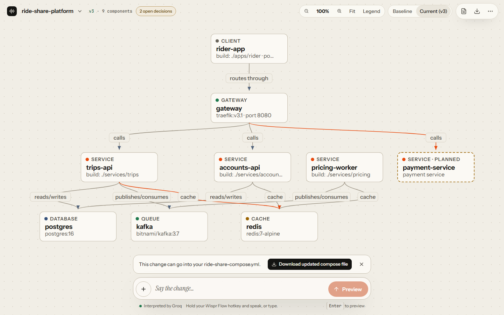
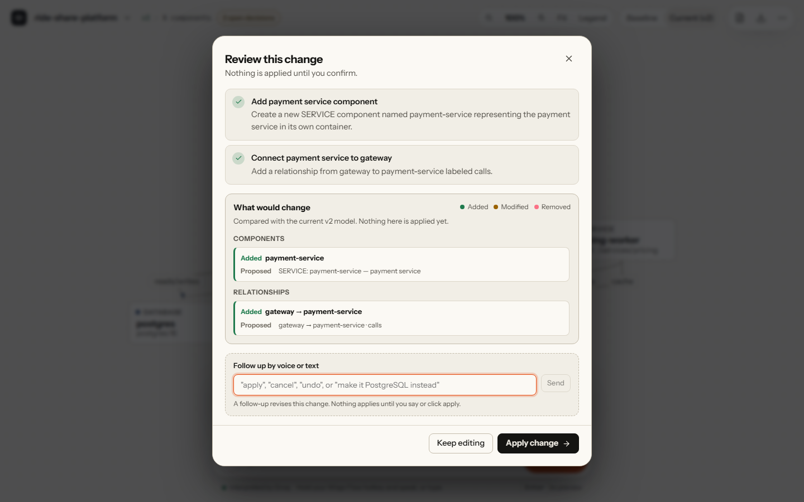

# VoiceArchitect

Voice keeps your architecture diagram in sync with your code.

Architecture diagrams go stale the week they are drawn: updating one means opening a drawing tool and remembering what the code actually runs, so nobody does it. VoiceArchitect draws the diagram from your docker-compose file, lets you change it by saying the change with Wispr Flow, shows the exact diff before anything applies, and checks the diagram against newer code.

**Run it:** not hosted yet. Run it locally in two minutes (see [Try it](#try-it)), then click **Start guided demo**, or open `/app?demo=guided`.





## The loop

1. **Import your docker-compose file.** In the workspace at `/app`, open **Switch project → Import docker-compose** and pick the `docker-compose.yml` (or `compose.yaml`) from your project folder, usually at the root of the repo. The diagram is drawn from your real services, `depends_on`, and the connection strings in their environment variables.
2. **Say the change.** Click the instruction box, hold your Wispr Flow hotkey, and speak, in English or Hinglish: "order service ko Kafka se connect karo". A model (Groq's `openai/gpt-oss-120b`, measured below) turns it into a short list of explicit operations, and every operation is checked against the current model and the Zod schema.
3. **Review the exact diff.** Nothing changes yet. In the follow-up field, say "make it PostgreSQL instead" to revise, "undo that" to step back, or "cancel".
4. **Say "apply".** The diagram, the API contract, the risks, and the tasks update together, and every applied change can be undone. The workspace, its undo history, and its branches are saved in your browser, so a reload or a Wispr Flow sign-in brings you back to the same stack.
5. **Write it back to your compose file.** After an applied change, **Download updated compose file** shows a unified diff of your own file with the change written in: a new cache, database, or queue becomes a service with a pinned image, a `depends_on` entry, and a connection-string variable, and services removed from the diagram are listed before anything is dropped. Comments and ordering are kept. Application services drawn in the diagram are not written, since only you know their image or build context.
6. **Check against the code.** When the code moves on, compare the diagram with the newer compose file. New and retired services become one reviewable sync; components planned in the diagram but not built yet are kept and shown dashed.

Decisions from a meeting can enter the same loop: import a Wispr Flow Notetaker summary or Scratchpad note, or paste notes, and they become a proposal you review like a spoken one.

## Built around Wispr Flow

[Wispr Flow](https://wisprflow.ai) is a system-wide dictation app: you hold your Wispr Flow hotkey, speak, and the text is typed into whichever field has focus. VoiceArchitect is built around that.

- **One instruction box.** Dictation lands there as plain text; no Wispr code is involved. The guided demo asks you to say each step, with "Type it for me" only as the fallback for people without Wispr Flow.
- **English and Hinglish.** Wispr Flow supports Hinglish, and so does the interpreter: "order service ko Kafka se connect karo" becomes the same operations as "connect the order service to Kafka".
- **The whole review is spoken.** The follow-up field takes focus when the review opens, so you can revise, undo, cancel, or say "apply" (or "haan apply karo") without touching the mouse. Nothing applies without an explicit apply.
- **Cleanup for architecture words.** Flow's Backtrack already removes fillers and self-corrections. The app also fixes product names that dictation tends to get wrong, such as "post gres" → PostgreSQL and "rabbit mq" → RabbitMQ.
- **Command Mode works here** because the box is ordinary text: select your instruction and use Flow's Command Mode to rewrite it in place. Command Mode needs a paid Wispr Flow plan or trial.
- **Dictionary help.** One click copies the loaded model's component and technology names so you can add them to your Flow dictionary.
- **Import from Wispr Flow.** **Import from Wispr Flow or paste notes** connects to Wispr Flow's read-only MCP server (`https://api.wisprflow.ai/connect/mcp`) with your own Wispr Flow sign-in (authorization code flow with PKCE). The sign-in is sealed with AES-256-GCM into an HttpOnly cookie that only the server can open, so it survives a server restart, and an expired access token is refreshed automatically; the browser code never sees a token. It lists recent Notetaker meetings and Scratchpad notes and reads only the summary or note you pick, never transcripts or dictation history. The text goes to the model as quoted data, not instructions, and whatever it proposes still goes through validation and the review diff. Wispr Flow requires Notetaker and MCP access on the account. **Status: tested against mocks of Wispr's sign-in and MCP servers; not yet verified with a real Wispr Flow sign-in.**

Not integrated: any Wispr Flow API to start dictation or read dictations (none is documented for web pages, and the MCP server does not expose dictation history), and a dictionary import file (the format is undocumented). Without Wispr Flow you can type, paste notes, or use **Mic** in the command bar's **+** menu (the browser's own speech recognition, as a fallback). Sources for every statement are in [docs/wispr-notes.md](docs/wispr-notes.md).

## Try it

In the app, **Start guided demo** (`/app?demo=guided`) imports an example stack and walks three steps: an English change, a Hinglish change, and a check against the next version of the compose file.

To use your own project:

1. Find its compose file: `docker-compose.yml`, `docker-compose.yaml`, `compose.yml`, or `compose.yaml`, usually at the root of the repo. If the project is only on GitHub, open the file there and use **Download raw file**.
2. Open `/app?import=compose` (or **Use my own stack** on the first screen) and choose the file or drop it on the panel. It is read in your browser and not uploaded; when you preview a change, a summary of the diagram (components, connections, API operations, and requirements) is sent to the model, never the file itself.
3. When the code changes, open **Switch project → Check against code** and pick the newer version of the same file.

No compose file? Use **Switch project → Try example stack**, or open `/app?sample=ride-share`. Projects described only in Kubernetes manifests, Terraform, or a plain list of services cannot be imported yet.

Locally:

```sh
npm ci
cp .env.example .env.local   # then set GROQ_API_KEY (free tier, the measured interpreter)
npm run dev
```

With a key, every preview is a live model call. If the call cannot be made (no key, a rate limit, the daily cap, a timeout), the app answers from a recorded model answer for the same request when it has one, otherwise from a small set of offline rules, and a badge says which.

## How well it understands

On 22 labelled instructions (11 English, 11 Hinglish), scored by the structural change actually applied to the model:

| Interpreter | Correct cases | English | Hinglish |
|---|---|---|---|
| Groq `openai/gpt-oss-120b`, mean of 3 runs | 18.3 / 22 (range 18 to 19) | 9.3 / 11 | 9 / 11 |
| Offline rules, no key | 13 / 22 | 6 / 11 | 7 / 11 |

Claude is supported (`claude-opus-5-5`, used when `ANTHROPIC_API_KEY` is set) but not measured yet. Method, full results, and the commands to measure Claude are in [docs/DEVELOPING.md](docs/DEVELOPING.md#evals).

## Limitations

- The Wispr Flow import is tested against mocks only until a real sign-in has been done. A sign-in lasts 8 hours. It survives restarts only when the server has `WISPR_SESSION_SECRET` set (the Render blueprint generates one); without it, a restart means connecting again. Disconnect deletes the cookie and refuses copies of it until that server restarts.
- Offline mode understands only a handful of request patterns; full understanding needs a model key.
- The workspace is saved in this browser only (localStorage), with the last 25 undo steps per branch. Another browser or device starts fresh, and clearing site data clears it.
- Drift checks compare services, images, and connections. Ports, volumes, and environment values are not modeled.
- The compose write-back adds caches, databases, and queues (with a pinned image and credentials read from `.env`), `depends_on`, and connection strings, and removes services and `depends_on` entries. It never invents an image for an application service, and a connection string left behind by a removed connection is flagged for you to delete rather than deleted.
- Risks are findings computed from the model, not from production telemetry; tasks are proposals and are not sent to an issue tracker.

The **More** menu holds extra tools that are not part of the loop above.

## More

- [docs/DEVELOPING.md](docs/DEVELOPING.md): running, deploying, configuration, security headers, evals, code layout, and tests
- [docs/wispr-notes.md](docs/wispr-notes.md): what Wispr Flow documents, with sources
- [docs/SUBMISSION.md](docs/SUBMISSION.md): submission notes and a judge checklist

MIT, 2026. Built for the WeMakeDevs x Wispr Flow No Hands challenge.
